# Awesome-Generative-Songwriting-Vocal-Synthesis-Studio

  

  

  

  

  

  

# 🎤 Top Generative Songwriting & Vocal Synthesis Studio

**Curated List of SaaS/Commercial Platforms & Open-Source GitHub Projects**  

*Focused on Full-Song Lyrics-to-Music Studios (YuE2-Studio, YuE, ACE-Step, DiffRhythm), Singing Voice Synthesis (DiffSinger, OpenUtau, VISinger), Voice Conversion (RVC, Seed-VC) & Vocal Stem Isolation*  

**Last updated: November 2026**

This repository tracks notable **SaaS/Commercial platforms** and **open-source projects** for **Generative Songwriting & Vocal Synthesis Studio**. These tools power end-to-end lyrics-to-song composition with expressive lead and backing vocals (`timoncool/YuE2-Studio`, `YuE`, `ACE-Step`, `DiffRhythm`), MIDI-driven singing voice synthesis (`DiffSinger`, `OpenUtau`, `ACE Studio` open tools), zero-shot singing voice conversion (`Seed-VC`, `RVC`, `so-vits-svc`), and studio-grade vocal stem separation (`UVR5`, `Demucs`) for songwriters, vocal producers, and audio AI builders.

**Examples** include Suno AI, Udio, Splash Pro (Popgun), Soundraw, Mubert, Boomy, Beatoven.ai, AIVA, Soundful, and Loudly (the category leaders).

**🚀 Open-source emphasis**: This section is heavily expanded with every major active project for full-song lyrics & vocal studios (`timoncool/YuE2-Studio`, `YuE`, `ACE-Step`, `DiffRhythm`, `Bark`), singing voice synthesis & UTAU studios (`OpenUtau`, `DiffSinger`, `Amphion`, `Sinsy`), singing voice conversion (`Seed-VC`, `Retrieval-based-Voice-Conversion-WebUI`, `GPT-SoVITS`), and vocal isolation/pitch correction (`Ultimate Vocal Remover GUI`, `Demucs`, `CREPE`, `Basic Pitch`) — ideal for independent artists crafting vocal songs locally without SaaS subscriptions.

🤝 Contributions welcome! Open a PR to add/update entries. Keep descriptions factual and link to official sites.

## 📑 Table of Contents

- [📊 Sector Overview & Market Dynamics](#-sector-overview--market-dynamics)

- [☁️ SaaS/Hosted & Commercial Platforms](#️-saashosted--commercial-platforms)

- [💻 Open-Source GitHub Projects](#-open-source-github-projects)

- [🛠️ How to Contribute](#️-how-to-contribute)

- [⚠️ Disclaimer](#️-disclaimer)

- [💖 Support & Thank You](#-support--thank-you)

## 📊 Sector Overview & Market Dynamics

The global Generative AI Songwriting, Singing Voice Synthesis & Creator Audio market is valued at approximately **$3.8B–$5.4B+ in 2026**, expanding at a ~30%–38% CAGR driven by lyric-conditioned vocal diffusion models, virtual singers, and DAW-integrated vocal co-pilots. The commercial SaaS layer exhibits **strong consolidation** around full-song vocal platforms (Suno AI, Udio) and creator music libraries (Soundraw, Beatoven.ai, Mubert), while the **local GPU songwriting studio, singing voice synthesis (SVS), and voice-conversion ecosystems are thriving via open-source releases** (`YuE2-Studio`, `YuE`, `ACE-Step`, `DiffRhythm`, `OpenUtau`, `DiffSinger`, `Seed-VC`).

## ☁️ SaaS/Hosted & Commercial Platforms

*Sorted descending by company valuation / annual revenue scale.*

| Platform | Description | Company Scale (Valuation / Revenue) | Starting Paid Tier | Free Tier / Trial Limit |

| :--- | :--- | :--- | :--- | :--- |

| **[Suno AI](https://suno.com)** | Frontier AI songwriting and vocal synthesis studio generating complete radio-ready songs, custom lyrics, vocal stems, and Remi compositions. | **~$500M+ Valuation** ($125M+ VC funding led by Lightspeed/Nat Friedman) | **$8 / month** billed annually ($10/mo monthly for Pro plan, 2,500 credits / ~500 songs/mo) | **Forever Free Basic Plan** (**50 free credits daily** (~10 songs/day) for non-commercial personal use with Suno attribution) |

| **[Udio](https://udio.com)** | High-fidelity generative songwriting and vocal studio featuring multi-track stem exports, lyric/vocal inpainting, and audio-to-audio remixing. | **~$150M–$300M Est. Valuation** ($10M+ seed backed by a16z & music industry leaders) | **$8 / month** billed annually ($10/mo monthly for Standard plan, 1,200 credits/mo) | **Forever Free Plan** (**10 daily credits + 100 monthly credits** for non-commercial songs with standard generation queues) |

| **[Splash Pro (Popgun)](https://splashmusic.com)** | AI songwriting, text-to-singing/rap vocals, and beat-production platform engineered for vocalists, producers, and game creators. | **~$30M–$50M Est. Valuation** ($20M+ VC funding backed by Khosla/bitkraft) | **$10 / month** billed annually ($15/mo monthly for Starter; $35/mo Max with commercial rights) | **Forever Free Starter Tier** (Unlimited personal preview tracks and basic text-to-vocal/beat generation in browser) |

| **[Soundraw](https://soundraw.io)** | Royalty-free AI music and backing-track composer for songwriters and creators, allowing interactive bar-by-bar customization of arrangement and energy. | **~$20M–$40M Est. Valuation** (~$12M+ VC funding; Tokyo/US AI music studio) | **$11.04 / month** billed annually ($16.99/mo monthly for Creator plan) | **Forever Free Preview Plan** (**Unlimited AI track generation and customization** in browser; paid plan required to download WAV/MP3 files) |

| **[Mubert](https://mubert.com)** | Real-time generative music engine and API producing infinite royalty-free backing tracks, stems, and adaptive soundscapes for creators and apps. | **~$15M–$30M Est. Valuation** (~$5M+ est. ARR; >100k content creators) | **$11.69 / month** billed annually ($14/mo monthly for Creator plan, 500 tracks/mo) | **Forever Free Ambassador Plan** (Up to **25 free generated tracks/month** with Mubert audio watermark/attribution) |

| **[Boomy](https://boomy.com)** | Instant AI songwriting and streaming distribution platform enabling creators to compose original tracks, record custom vocals over AI beats, and release to Spotify. | **~$15M–$25M Est. Valuation** (Venture-backed US generative music platform; >20M songs created) | **$9.99 / month** for Creator plan (500 saves/mo + 10 commercial releases/mo) | **Forever Free Plan** (Unlimited song creation, custom vocal recording, and up to **25 free track saves** for personal use) |

| **[Beatoven.ai](https://beatoven.ai)** | Mood-based, royalty-free AI music composer built for creators and storytellers with multi-track stem editing and adaptive emotional transitions. | **~$10M–$20M Est. Valuation** (Venture-backed Indian/global audio AI startup) | **$6 / month** for 15 minutes of commercial downloads/month (or **$3/min** pay-as-you-go) | **Forever Free Trial Workspace** (**Unlimited track generation and editing** in browser + 1 free complimentary track download upon signup) |

| **[AIVA](https://aiva.ai)** | AI orchestral, cinematic, and pop composition assistant generating structured song themes with full MIDI and multi-track stem exports. | **~$10M–$20M Est. Valuation** (Backed by NetEase; Luxembourg AI composition pioneer) | **€11 / month** billed annually (€15/mo monthly for Standard; €33/mo Pro with full copyright) | **Forever Free Plan** (**3 free downloads per month** up to 3 minutes each for non-commercial use with AIVA attribution) |

| **[Soundful](https://soundful.com)** | AI music and beat studio producing studio-quality royalty-free backing tracks, stems, and MIDI packs across 50+ pop, R&B, hip-hop, and EDM styles. | **~$10M–$20M Est. Valuation** (Venture-backed San Diego music AI company) | **$5.00 / month** billed annually ($9.99/mo monthly for Content Creator plan, 100 downloads/mo) | **Forever Free Plan** (Unlimited track previews + **10 free MP3 downloads/month** for personal projects with attribution) |

| **[Loudly](https://loudly.com)** | AI music studio and royalty-free catalog combining text-to-music generation, stem separation, and instant soundtrack customization. | **~$10M–$15M Est. Valuation** (Berlin-based music technology & AI platform) | **$5.99 / month** billed annually ($11.99/mo monthly for Personal plan, 300 downloads/mo) | **Forever Free Plan** (Up to **25 free AI track generations/month** and 1 free MP3 download/month for personal use) |

## 💻 Open-Source GitHub Projects

| Project | License / Hosting Cost | Free Tier / Self-Hosted Limit | Description |

| :--- | :--- | :--- | :--- |

| **[YuE2-Studio (`timoncool/YuE2-Studio`)](https://github.com)** | **Open-Source** ($0 self-hosted/local AI songwriting & vocal studio UI) | **100% Free forever** (Unlimited local lyrics-to-song generation, vocal/instrumental synthesis, and studio workflow management) | Open-source generative songwriting and vocal synthesis studio interface built to make local full-song AI production effortless and intuitive. |
